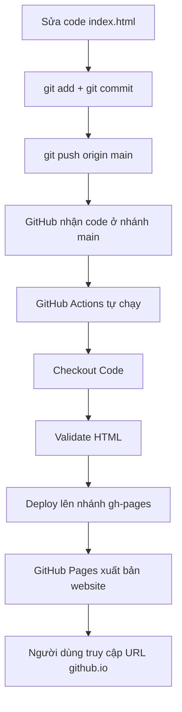

# Báo cáo Lab 1: Trải nghiệm DevOps Workflow End-to-End

- **Website:** https://nch-lgtm.github.io/devops-lab1-portfolio/
- **Repository:** https://github.com/nch-lgtm/devops-lab1-portfolio

## 1. Bảng so sánh: DevOps vs Truyền thống

| Tiêu chí | Cách THỦ CÔNG (Traditional) | Cách DEVOPS (CI/CD Pipeline) |
|---|---|---|
| **Làm sao để deploy?** | Tự sao chép file lên máy chủ (FTP hoặc copy tay), cấu hình máy chủ, rồi mở trình duyệt kiểm tra từng bước. | Chỉ cần `git push` lên nhánh `main`, GitHub Actions tự chạy pipeline (Checkout, Validate HTML, Deploy). |
| **Mất bao lâu?** | Khoảng 15-30 phút cho mỗi lần cập nhật. | Khoảng 10 giây (lần chạy thực tế: 9 giây). |
| **Ai làm deploy?** | Con người (lập trình viên hoặc quản trị viên hệ thống). | GitHub Actions (máy ảo Ubuntu tự thực hiện). |
| **Có bị sai sót không?** | Dễ sai sót: quên upload file, upload nhầm phiên bản, cấu hình sai. | Ít sai sót vì mỗi lần chạy theo cùng một quy trình trong `deploy.yml`. Nếu có lỗi (như lần chạy #1 do YAML sai) thì pipeline báo ngay. |
| **Rollback nếu lỗi?** | Tìm lại bản cũ, upload lại thủ công, dễ nhầm lẫn. | `git revert <commit>` rồi push, pipeline tự deploy lại bản cũ. |
| **Làm sao biết deploy thành công?** | Tự mở website kiểm tra bằng mắt, không có log rõ ràng. | Tab Actions hiển thị ✅ hoặc ❌ cùng log chi tiết từng step. |

## 2. Sơ đồ DevOps Workflow

Đối chiếu vòng đời DevOps:

| Giai đoạn | Trong lab này |
|---|---|
| Plan | Xác định làm trang portfolio và pipeline tự động |
| Code | Viết `index.html`, `deploy.yml` |
| Build | Checkout mã nguồn trên máy ảo Ubuntu |
| Test | Step Validate HTML kiểm tra file tồn tại |
| Deploy | Đẩy nội dung lên nhánh `gh-pages` |
| Monitor | Theo dõi tab Actions và truy cập website |

## 3. Trả lời câu hỏi

**Câu 1. DevOps workflow tự động hóa những bước nào mà cách thủ công phải làm bằng tay?**
Kiểm tra file, lấy mã nguồn và deploy lên máy chủ. Chỉ cần `git push`, GitHub Actions làm toàn bộ các bước còn lại.

**Câu 2. Nếu deploy sai, làm sao quay lại phiên bản cũ?**
Dùng `git revert <commit>` rồi push, pipeline tự deploy lại bản cũ và vẫn giữ nguyên lịch sử. Cũng có thể dùng `git reset --hard <commit>` nhưng phải push ép nên ít an toàn hơn.

**Câu 3. GitHub Actions tiết kiệm bao nhiêu thời gian so với thủ công?**
Thủ công mất khoảng 15-30 phút mỗi lần (tải file, upload, cấu hình, kiểm tra). Với DevOps chỉ cần `git push` và chờ khoảng 10 giây (lần chạy thực tế của mình là 9 giây).

## 4. Bài học rút ra

- Lỗi `No event triggers defined in 'on'`: file YAML bị hỏng khi dán bằng Notepad, phải sửa lại cho đúng thụt lề.
- Lỗi `non-fast-forward`: sửa file trên GitHub mà chưa `git pull` về máy nên push bị từ chối.
- Xung đột merge ở `index.html`: hai nơi cùng sửa một file, phải giải quyết xung đột trước khi `rebase --continue`.
- Kết luận: luôn `git pull` trước khi sửa và push khi làm việc ở nhiều nơi.
